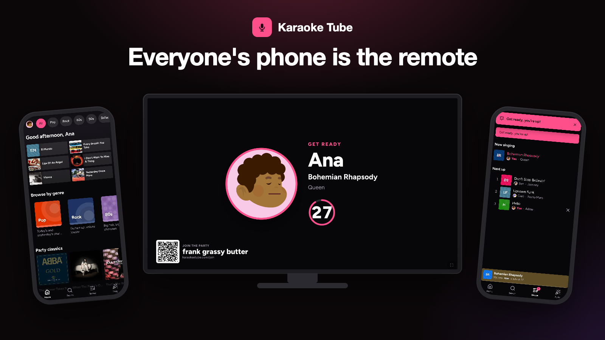
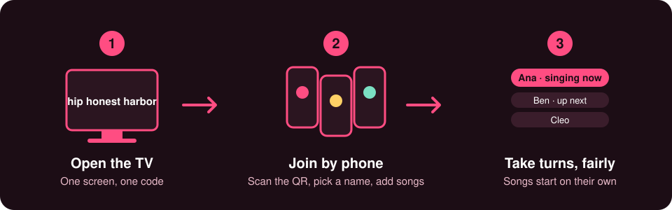
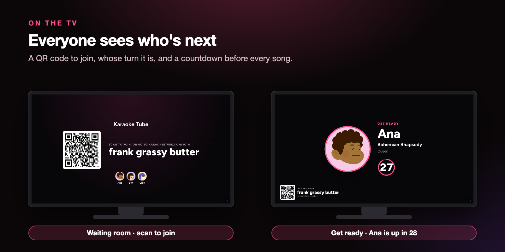
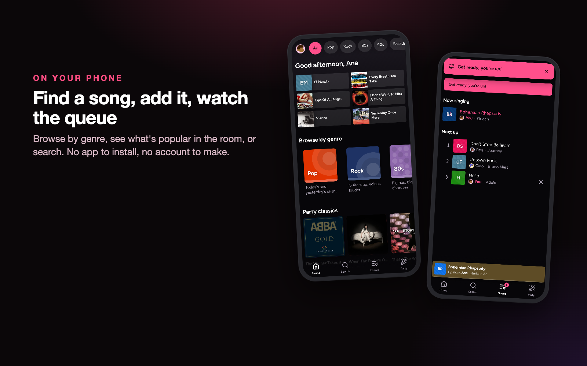
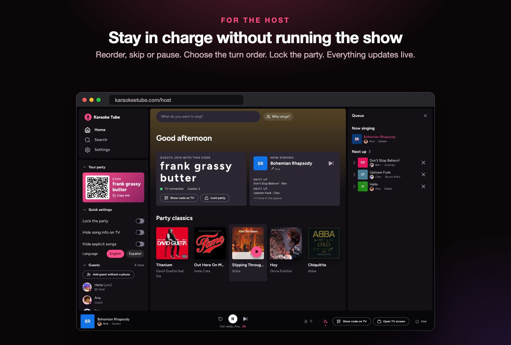
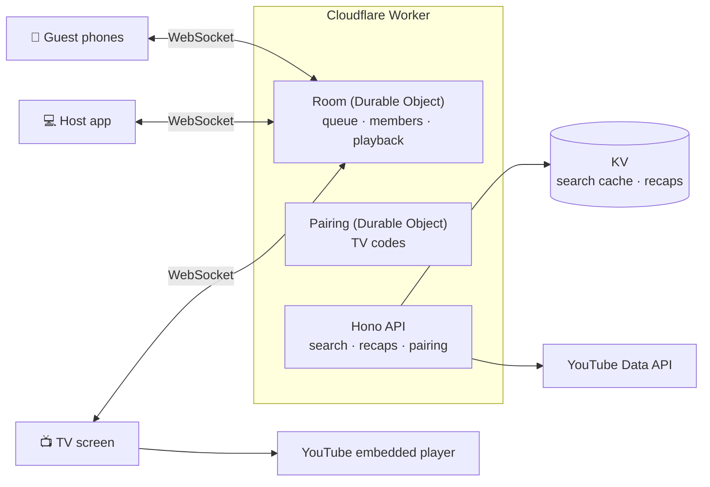

<div align="center">


# Karaoke Tube

**Karaoke parties where everyone's phone is the remote.**

Free · No install · No sign-up · English and Spanish

### [Start a party → karaokeetube.com](https://karaokeetube.com)

</div>



---

## Contents

**For everyone:** [Start a party in 1 minute](#start-a-party-in-1-minute) · [What you can do](#what-you-can-do) · [Questions](#questions)
**For developers:** [How it's built](#how-its-built) · [Design decisions](#design-decisions) · [Run it locally](#run-it-locally) · [Testing](#testing) · [Docs](#docs)

---

# For everyone

Karaoke nights with friends and family kept stalling: pauses between songs, nobody sure whose turn it was, and a host busy keeping things fair instead of singing. Karaoke Tube runs the party for you, so everyone, the host included, gets to sing.

## Start a party in 1 minute

1. **Host: open [karaokeetube.com](https://karaokeetube.com)** on your phone or laptop and start a party.
2. **Open the TV screen** on whatever screen the room will watch. It shows a short code and a QR code.
3. **Everyone else: scan the QR code** (or enter the code) on their phone, pick an avatar and a name, and add songs.
4. **Sing.** Songs start on their own, and the TV shows whose turn is next with a countdown.

You don't need to install anything or create an account.



## What you can do

| | |
|---|---|
| **As a guest** | Find songs by genre, see what's popular in the room, or search. Can't find a song? Paste a YouTube link. Sing duets or group songs, and send reactions if the host turned them on. |
| **As the host** | Reorder, remove, skip or pause songs. Choose how turns work (everyone in rotation, first come first served, or you pick). Limit how many songs each guest can add, or lock the party once everyone is in. |
| **On the TV** | Who is singing, the lyrics video, a countdown to the next singer, the queue and the join code. |
| **Afterwards** | A recap of the night at a link you can share, kept for 30 days. |

**Fair turns:** the queue runs in rounds, so every singer gets one song before anyone gets a second. The host can still change anything.

### A closer look



**On the TV.** Before the party it shows a QR code and the join code, with every guest's avatar as they arrive. Between songs it shows who is up next and a countdown, so nobody has to ask "whose turn is it?".



**On your phone.** Browse by genre, see what's popular in the room, or search. Your songs and your turn are always one tap away in the Queue tab, and the phone tells you when you're up.



**For the host.** One screen with the party code, the queue (drag to reorder, tap to remove), quick settings and the guest list. Skip, pause or lock the party at any time.

## Questions

**Is it free?** Yes.

**Do guests need an account or an app?** No. They open the link or scan the QR code in their phone's browser.

**What do I need?** A screen that can open a website (a TV with a browser, or a laptop connected to the TV), plus everyone's phones and an internet connection.

**Where do the songs come from?** From karaoke videos on YouTube, played in YouTube's own player. Nothing is downloaded or stored.

**A song won't play. What happens?** Some videos can't be played outside YouTube. Karaoke Tube skips them and tells the singer and the host, so the party keeps going.

**Which languages are supported?** English and Spanish.

**I can't find a song.** Paste its YouTube link in the search box and it will be added.

---

# For developers

> **Not technical? You can stop here.** Everything above is all you need to use the app. The rest is for people who want to see how it's made or run it themselves.

## How it's built

**In plain words:** each party is a small "room" that lives on the server and keeps the one true list of who sings next. The TV, the host's screen and every guest's phone stay connected to that room, so they all show the same thing at the same time. The videos themselves are played by YouTube's own player on the TV screen.



```
apps/
  api/        Hono on Cloudflare Workers + Durable Objects. Also serves apps/web in production.
  web/        React + Vite: guest phone screens, the host app (/host) and the TV screen (/tv)
packages/
  shared/     Types and the WebSocket protocol shared by every app
  client/     Room and search clients
  ui/         Shared UI components
  catalog/    Song catalog build tools: collect, label, cover art
e2e/          Playwright scenarios: whole "nights" across host, phones and TV
```

**Stack:** TypeScript, React, Vite, Hono, Cloudflare Workers, Durable Objects, KV, D1, Analytics Engine, YouTube Data API and IFrame player, Vitest, Playwright, pnpm workspaces.

## Design decisions

- **One room, three screens.** Each party is one Durable Object that owns the queue, the members and the WebSocket connections. Phones, host and TV all render the same server state, so they can't drift apart.
- **YouTube's free quota is small** (about 100 searches a day). The app ships its own song catalog, built from karaoke channels and searched in the browser (MiniSearch in a web worker), and only asks the server when the catalog comes up short. Server results are cached in KV (searches 7 days, videos 30 days), and if the quota runs out guests can still paste a link.
- **No video is downloaded or re-hosted.** Playback is YouTube's own embedded player. Songs that can't be embedded are skipped, and the singer and host are told.
- **Short codes, guarded.** TV pairing codes have 5 digits and live 2 minutes. The TV swaps its code 30 seconds before it expires, and entering a code is limited to 20 tries a minute per IP.
- **Cheap to run, easy to watch.** Key events are logged as JSON and written to Analytics Engine in priority tiers, so a flood of events can't slow a party. No personal data is logged. Details in [docs/operations.md](docs/operations.md).
- **Accounts are optional.** Favorites, friends and a party log are built but switched off for now. Guests only.

## Run it locally

```sh
corepack enable pnpm   # once
pnpm install
pnpm dev               # api on :8787, web on :5173
```

Then open http://localhost:5173/host/new, start a party and click "Open TV screen" (`/tv/<code>`). Guests join at `/join/<code>`.

### YouTube API key

Search (`/api/search`, `/api/videos/:id`) calls the YouTube Data API v3. Create a key in Google Cloud Console (APIs & Services → enable "YouTube Data API v3" → Credentials → API key), then:

```sh
cp apps/api/.dev.vars.example apps/api/.dev.vars          # local: put the key in YOUTUBE_API_KEY=
cd apps/api && npx wrangler secret put YOUTUBE_API_KEY    # production
```

Without a key, or when the daily quota (10,000 units) runs out, search returns `503 { "error": "search_unavailable" }` and the UI asks for a pasted link.

### Commands

```sh
pnpm typecheck
pnpm build
pnpm --filter @karaoke-tube/api cf-typegen   # after editing wrangler.jsonc
pnpm --filter @karaoke-tube/api deploy       # builds web + deploys the Worker (needs `wrangler login`)
```

## Testing

```sh
pnpm --filter @karaoke-tube/api test   # room, queue, playback, search and pairing rules (Workers runtime)
pnpm e2e                               # 42 whole-app scenarios with Playwright (see e2e/README.md)
```

The unit tests check the room's rules one message at a time. The end-to-end scenarios drive the real host app, several phones and the TV page against a local API, with a fake YouTube player, and check that every screen shows the same queue and countdown at every step.

## Docs

- [docs/operations.md](docs/operations.md): backups, monitoring, YouTube rules
- [docs/e2e-scenarios.md](docs/e2e-scenarios.md): the end-to-end nights
- [docs/specs/](docs/specs/): the original build specs
